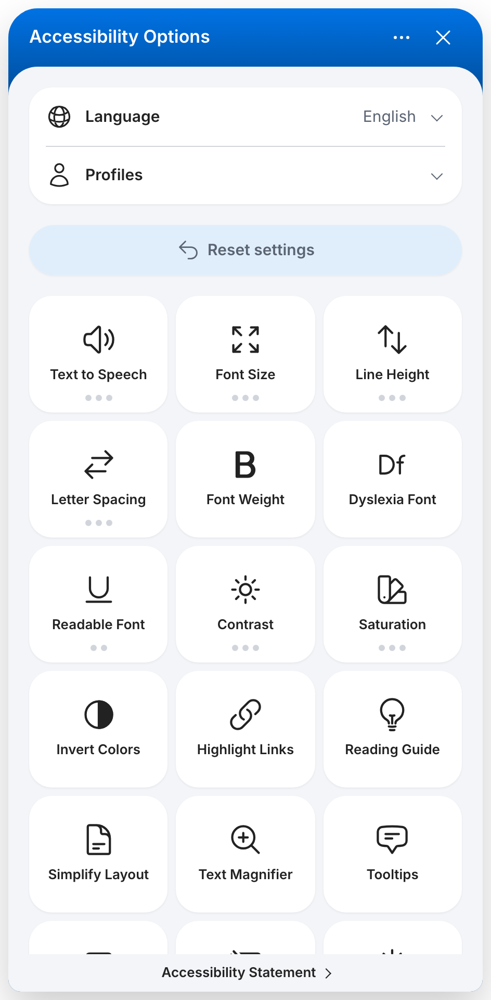

# AccessibleWeb Widget

[](https://www.npmjs.com/package/accessible-web-widget)
[](https://www.jsdelivr.com/package/gh/ifrederico/accessible-web-widget)
[](https://github.com/ifrederico/accessible-web-widget/actions/workflows/ci.yml)
[](LICENSE)

Most accessibility overlays promise to magically fix your site. This isn't that.

This is a small floating panel that gives your visitors controls they actually want — font sizing, contrast modes, a dyslexia-friendly font, animation pausing, text-to-speech, and more, in 54 languages. Think of it as the browser's built-in accessibility settings, just easier to find.

Real accessibility means semantic HTML, proper ARIA, keyboard navigation, and alt text baked into your code. No widget replaces that work. We support the [Overlay Factsheet](https://overlayfactsheet.com/) and built this as a complement, not a substitute. To find the issues actually worth fixing, run the companion [Accessible Web Scanner](https://github.com/ifrederico/accessible-web-scanner) over your sitemap.

<p align="center">
  
</p>

**[See the demo →](https://accessibleweb.pages.dev/)**

> **⚠️** This widget does not guarantee compliance with WCAG, ADA, Section 508, or any other standard. See the full [DISCLAIMER](DISCLAIMER.md).

## Quick start

Drop this into your HTML and you're done:

```html
<script src="https://cdn.jsdelivr.net/gh/ifrederico/accessible-web-widget@latest/dist/accessible-web-widget.min.js"></script>
```

It initializes on page load. No config needed.

For production, pin a specific version — `@latest` ships new releases to your site without review:

```html
<script src="https://cdn.jsdelivr.net/gh/ifrederico/accessible-web-widget@1.7.0/dist/accessible-web-widget.min.js"></script>
```

Also on npm for bundler setups:

```bash
npm install accessible-web-widget
```

```js
import 'accessible-web-widget'; // auto-initializes, same as the script tag
```

Or self-host — just download `dist/accessible-web-widget.min.js` and serve it yourself.

## What you get

- **Profiles** — One-tap presets: Seizure Safe, Vision Impaired, ADHD Friendly, Dyslexia Friendly
- **Text** — Font size, line height and letter spacing (three steps each), bold, a dyslexia font with a tile of its own, and two more readable fonts
- **Color** — Contrast (smart, which recolors only hard-to-read text; dark; light), invert, saturation (low/high/monochrome)
- **Reading** — readable fonts (OpenDyslexic, Atkinson Hyperlegible, Lexend), reading guide, link highlighting, reader mode, text-to-speech, text magnifier, tooltips (the hidden name of an icon button or the description of a picture, shown on hover and on keyboard focus), page structure navigator (headings/landmarks/links)
- **Interaction** — Large cursor, pause animations (including videos and animated GIFs), hide images, mute sounds

Plus: 54 languages (including RTL Arabic, Hebrew, Persian, and Urdu), persistent settings, system preference detection (`prefers-reduced-motion`, `prefers-contrast`), screen-reader announcements for every toggle, keyboard accessible, and mobile friendly. The widget UI lives in a shadow root, so your site's CSS can't break it and its styles can't leak into your page.

Platform wrappers for WordPress and Shopify live in [`platforms/`](platforms/).

## Configuration

Everything below is optional. The widget works with zero config.

### Position, size, and language

```html
<div data-acc-position="bottom-right"></div>  <!-- bottom-right (default) | bottom-left | top-left | top-right -->
<div data-acc-offset="24,24"></div>           <!-- x, y in pixels -->
<div data-acc-size="44"></div>                <!-- px, rem, or any CSS unit -->
<div data-acc-lang="en"></div>
<div data-acc-icon="default"></div>           <!-- default | icon-2 | icon-3 | icon-4 -->
```

Language resolves in this order: the visitor's own pick in the widget menu → `data-acc-lang` / `options.lang` → the page's `<html lang>` → the browser language → English.

### Hide the button, open the panel from your own UI

If you already have a toolbar or footer link for accessibility, hide the floating button and drive the panel yourself:

```html
<script src="…/accessible-web-widget.min.js" data-acc-hide-button="true" defer></script>

<button type="button" onclick="AccessibleWebWidget.instance.open()">Accessibility options</button>
```

`AccessibleWebWidget.instance` exposes `open()`, `close()`, and `toggle()`. They also work with the default button visible.

### Visitors can move or hide the button

The panel's header has a "more" button (three dots) beside Close. It opens two options:

- **Move widget** flips the floating button, and the panel with it, to the other side of the screen. The choice is remembered on that device. It keeps your top or bottom setting.
- **Hide widget** asks for how long: this visit, one day, one week, or always. The button then stays away on every page of your site. The timed choices end on their own. "Always" first tells the visitor that it lasts until they clear the site's data in their browser, and takes a second click.

While the button is hidden, the panel still opens through the skip link and through `AccessibleWebWidget.instance.open()`. Under the "more" button, Hide widget then shows as on, and clicking it brings the floating button back. You can also call `AccessibleWebWidget.instance.showButton()`.

The "more" button is not shown when you use `data-acc-hide-button`, since there is no floating button to move or hide.

### Content Security Policy

In modern browsers the widget works under a strict CSP with no configuration — styles are applied through constructable stylesheets, which `style-src` doesn't block. For older browsers, pass your page's nonce so the `<style>`-element fallback is allowed. The widget picks it up automatically from its own script tag's `nonce` attribute, or you can pass it explicitly:

```html
<script nonce="YOUR_NONCE" src="…/accessible-web-widget.min.js" defer></script>
<!-- or: data-acc-nonce="YOUR_NONCE" / window.AccessibleWebWidgetOptions = { nonce: "YOUR_NONCE" } -->
```

If your policy locks down remote requests, also allow the host you load the widget script from in `font-src` for the menu's font (or self-host it via `menuFontUrl`, or turn it off with `menuFont: "system"`), allow `font-src https://accessibleweb.pages.dev` for the dyslexia font (or self-host it via `dyslexiaFontUrl`), and — only if you allow dev tools — `script-src https://cdn.jsdelivr.net` for axe-core.

### Text-to-speech voices

TTS uses native browser voices. When enabled, visitors click any text block to hear it read aloud. Tapping the Text to Speech tile again steps through three speeds (normal, slow at 0.8×, fast at 1.3×) and then turns it off; the choice is remembered.

```html
<script>
  window.AccessibleWebWidgetOptions = {
    ttsNativeVoiceName: "Samantha",  // best-effort match
    ttsNativeVoiceLang: "en-US",
    ttsRate: 1.0,                    // 0.5 – 2.0, the normal speed; slow and fast scale from it
    ttsPitch: 1.0                    // 0 – 2.0
  };
</script>
```

### Font size

The Font Size tile has three steps, 110%, 125% and 150%; a fourth tap returns to 100%. Earlier versions used a slider: a size saved by it snaps to the nearest step, and the slider's `textScaleMinPercent`, `textScaleMaxPercent` and `textScaleStepPercent` settings are now ignored.

### The menu's font

The panel's text is set in [Inter](https://rsms.me/inter/). The font files sit in a `fonts/` folder beside the widget script (`dist/fonts/`), so they come from wherever you load the script from and no other server is contacted. Nothing is fetched until a visitor opens the panel, and then only the part of the font their language needs (about 48 KB for English). Languages Inter does not cover, such as Arabic, Hebrew, Chinese and Japanese, use the device's own font.

If you copy the script to your own server, copy the `fonts/` folder with it, or point the widget at the folder. If the files cannot be found, the panel uses the device's own font. To skip Inter altogether, set `menuFont` to `"system"`:

```html
<script>
  window.AccessibleWebWidgetOptions = {
    menuFontUrl: "/assets/fonts/", // the folder holding the inter-*.woff2 files
    // menuFont: "system"          // or: always use the device's own font
  };
</script>
```

### Readable font sources

The "Dyslexia Font" tile switches on OpenDyslexic, and the "Readable Font" tile steps through Atkinson Hyperlegible and Lexend. All three are loaded from accessibleweb.pages.dev by default and are SIL OFL licensed. To self-host any of them, point the widget at your own copies:

```html
<script>
  window.AccessibleWebWidgetOptions = {
    readableFontUrls: {
      dyslexic: "/fonts/OpenDyslexic3-Regular.woff",
      legible: "/fonts/AtkinsonHyperlegible-Regular.woff2",
      lexend: "/fonts/Lexend-Regular.woff2"
    }
    // dyslexiaFontUrl: "..." still works as a shorthand for the dyslexic entry
  };
</script>
```

### Dev tools

Developer mode adds inline annotation markers and a full accessibility report powered by axe-core. Useful for development, not meant for production. It is off by default and needs two keys, so a visitor cannot turn it on for your site.

First, allow it on your site with `data-acc-dev-tools` on the widget's script tag:

```html
<script src="…/accessible-web-widget.min.js" data-acc-dev-tools defer></script>
```

Or with the `devTools` option:

```html
<script>
  window.AccessibleWebWidgetOptions = { devTools: true };
</script>
```

Then add `?acc-dev` to the page URL (or `&acc-dev` if it already has a query string) when you want the tools on that visit. `?acc-dev=true` works too. Without both keys the widget shows no dev tools and never downloads axe-core. Before this version, `?acc-dev=true` turned developer mode on by itself on any site.

The audit engine (axe-core) loads from the jsDelivr CDN by default, pinned to a specific version with subresource integrity. To self-host it instead:

```html
<script>
  window.AccessibleWebWidgetOptions = {
    axeCoreUrl: "/js/axe.min.js",        // absolute or relative URL
    axeCoreIntegrity: ""                 // optional SRI hash for your copy
  };
</script>
```

## Browser support

Chrome/Edge 88+, Firefox 78+, Safari 14+, iOS Safari 14+, Chrome for Android.

## Contributing

Want to help? See [CONTRIBUTING.md](CONTRIBUTING.md) for setup, testing, and how to submit a PR.

## Bugs

[Open an issue](https://github.com/ifrederico/accessible-web-widget/issues) — include your browser/version, repro steps, expected vs. actual behavior, and screenshots if you can.

## License

MIT — see [LICENSE](LICENSE).

## Acknowledgments

- Icons: [Heroicons](https://heroicons.com/) (MIT) in the menu, [Google Material Icons](https://fonts.google.com/icons) (Apache 2.0) on the floating button
- Fonts: [Inter](https://rsms.me/inter/) by The Inter Project Authors, [OpenDyslexic](https://opendyslexic.org/) by Abbie Gonzalez, [Atkinson Hyperlegible](https://brailleinstitute.org/freefont) by the Braille Institute, [Lexend](https://www.lexend.com/) by the Lexend Project
